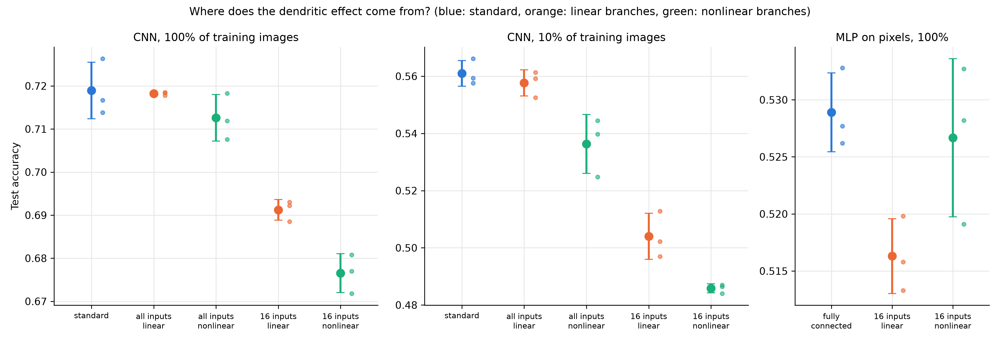

# Neuro-inspired networks

This project compares a small CNN on CIFAR-10 with versions that change how its hidden neurons work: dendritic branches, Dale's law and divisive normalization. The CNNs use the same convolutional architecture and initialization; trained independently, their convolution weights can diverge. The architectural changes are in the hidden layer.

The main question is whether dendritic branches help because they receive fewer inputs, because they apply their own nonlinearity, or both. A second experiment tests this in an MLP on raw pixels, following the random-sampling model of Chavlis & Poirazi (2025).

In these runs, branch nonlinearities helped the MLP but reduced accuracy in the CNN. The repository includes the training scripts, results tables and figures.

## Results



The clearest result was the difference between the two settings. With 16 inputs per branch, nonlinear branches reduced CNN test accuracy by an average of 1.47 percentage points compared with linear branches on the full training set. In the MLP, nonlinear branches improved accuracy by 1.04 points. Both directions held across all three seeds.

The dendritic MLP also reached close to the accuracy of the fully connected MLP with roughly two orders of magnitude fewer parameters. It did not reproduce the accuracy advantage reported by Chavlis & Poirazi, with early stopping used here for both models.

| Model | Test accuracy, full training set |
|---|---:|
| CNN baseline | 71.89 ± 0.65% |
| CNN, linear branches | 71.82 ± 0.04% |
| CNN, nonlinear branches | 71.26 ± 0.54% |
| CNN, sparse linear branches | 69.12 ± 0.24% |
| CNN, sparse nonlinear branches | 67.65 ± 0.45% |
| CNN, Dale's law | 72.37 ± 0.25% |
| CNN, divisive normalization | 71.45 ± 1.11% |
| Fully connected MLP | 52.89 ± 0.35% |
| MLP, sparse linear branches | 51.63 ± 0.33% |
| MLP, sparse nonlinear branches | 52.67 ± 0.69% |

Values are mean ± standard deviation over seeds 1, 2 and 3, from [model_comparison.csv](results/tables/model_comparison.csv). CNNs and MLPs differ in input representation, architecture, activation function and branch count. The opposite effects observed in these configurations do not isolate a single mechanism; the branch controls should be compared within each setting. Seed-by-seed differences are summarized in [paired_comparison.csv](results/tables/paired_comparison.csv).

A few other observations:

- Nonlinear branches also reduced CNN accuracy when branches received all inputs. The gap grew with fewer training images.
- Restricting CNN branches to 16 inputs reduced accuracy for both linear and nonlinear branches. It also reduced parameter counts, so this comparison does not isolate connectivity alone.
- Dale's law gave a small average improvement over the baseline, but three seeds are too few to draw a firm conclusion. Divisive normalization showed no clear accuracy benefit.
- Divisive normalization made hidden activity sparser and more class-selective. Dendritic models had more active units and lower class selectivity than their standard counterparts.
- Noise robustness varied between seeds without a clear separation between models.

See the figures for [learning with fewer labels](results/figures/low_data.png), [noise robustness](results/figures/noise_robustness.png) and [class representations](results/figures/class_rdms.png).

## Why these comparisons?

The first experiment tested three biological ideas in the same CNN. Dendritic branches performed worse than expected, which led to a closer look at the setup in Chavlis & Poirazi (2025): their networks use raw pixels and each dendrite receives only 16 inputs. The original CNN branches received all 4,096 hidden-layer inputs, split across eight branches.

The follow-up separates input sampling from branch nonlinearity. Each nonlinear model has a control with the same connections and parameters but no activation inside the branches. This makes it possible to test what the branch activation contributes. The MLP experiment follows the paper's random-sampling architecture and adds the same linear-branch control.

These are simplified neuron models. The biological motivation and implementation details are in [docs/background.md](docs/background.md).

## Models

### CNN

All CNNs use two convolution blocks, a hidden layer of 128 neurons and 10 outputs. Only the hidden-layer computation changes.

| Model | Hidden layer |
|---|---|
| `baseline` | Weighted sum followed by ReLU |
| `linear_branches` | Eight linear branches, followed by a weighted sum and ReLU at the soma |
| `dendritic` | Same branches, with ReLU inside each branch as well |
| `linear_branches_sparse` | Linear branches with 16 randomly sampled inputs each |
| `dendritic_sparse` | Nonlinear branches with 16 randomly sampled inputs each |
| `dale` | 80% excitatory and 20% inhibitory units, with fixed signs on outgoing weights |
| `divisive_norm` | ReLU activity divided by a learned positive offset plus mean hidden-layer activity |

In the dense branch models, each neuron receives all 4,096 inputs, randomly assigned to eight branches of 512. In the sparse models, each branch samples its own 16 inputs. The assignments stay fixed during training.

### MLP

The MLPs take the 3,072 image pixels directly. The dendritic architecture has 256 somata, each with 16 dendrites receiving 16 randomly sampled pixels. Activations use LeakyReLU with slope 0.1.

| Model | Architecture |
|---|---|
| `mlp_vanilla` | Fully connected 3072 → 4096 → 256 → 10 |
| `mlp_dendritic_sparse` | Sparse dendrites with a branch nonlinearity (dANN-R in Chavlis & Poirazi) |
| `mlp_linear_branches_sparse` | Same sparse connections, without the branch nonlinearity |

Parameter counts are recorded in [summary.csv](results/tables/summary.csv).

## Experiments and training

CIFAR-10 contains 60,000 colour images of size 32 × 32 in 10 classes. For each seed, the official training set is split into 45,000 training images and 5,000 validation images. The official 10,000-image test set is used for final evaluation. Models with the same seed share the split; reducing the training set leaves validation and test data unchanged.

The experiments use seeds 1, 2 and 3:

- **Part 1:** baseline, dense linear and nonlinear branches, Dale's law and divisive normalization, each with 10%, 25%, 50% and 100% of the training images.
- **Part 2:** dense and sparse branch models in the CNN with 10% and 100% of the training images, plus the three MLP models with the full training set.

The four planned follow-up comparisons were nonlinear versus linear sparse CNN branches, sparse versus dense nonlinear CNN branches, dendritic versus fully connected MLP, and nonlinear versus linear sparse MLP branches. Other comparisons are exploratory.

| Setting | Value |
|---|---|
| Optimizer | Adam |
| Learning rate | 0.001 |
| Batch size | 128 |
| Maximum epochs, full training set | 100 |
| Early stopping patience, full training set | 10 epochs |
| Model selection | Highest validation accuracy |

With fewer training images, the epoch limit and patience scale inversely with the training fraction: at 10%, they become 1,000 and 100 epochs. The checkpoint with the highest validation accuracy is used for test evaluation. CNN models with the same seed share initial convolution weights and training image order.

Early runs used fixed limits of 15 and then 30 CNN epochs. Some models were still improving near the limit, so the final runs use early stopping. Earlier results remain in the Git history. The MLP training schedule also differs from the paper's fixed 50 epochs.

Noise evaluation adds Gaussian noise at standard deviations of 0, 0.25, 0.5, 1.0 and 1.5 in normalized image space, using the same noise across models. Representation analysis measures positive activity, class selectivity and similarity between class representational dissimilarity matrices. `active_fraction` is the fraction of positive activations; `dead_fraction` means “fraction never positive on the evaluation set”. The latter does not establish that neurons are nonfunctional: MLP LeakyReLU neurons can carry information through negative activations.

## Running the project

From the repository root:

```bash
python3 -m venv .venv
source .venv/bin/activate
pip install -r requirements.txt
```

Train one model on the full training set, or on a smaller subset:

```bash
python3 scripts/train.py baseline 1
python3 scripts/train.py dendritic 1 10
```

Run the full experiments and their analyses:

```bash
bash scripts/run_all.sh
bash scripts/run_dendrite_study.sh
```

Both scripts use `--skip-existing` to skip runs only when checkpoint settings, source SHA-256 and recorded environment match. Missing provenance (including legacy checkpoints) or a mismatch triggers fresh training and replaces that run’s outputs. Direct `train.py` commands always retrain unless `--skip-existing` is supplied. On macOS, prefix a command with `caffeinate -i` to keep the machine awake. Training and analyses select NVIDIA CUDA first, then Apple MPS, then CPU.

CIFAR-10 is downloaded automatically into `data/`. Checkpoints in `results/models/` store weights, training settings, source SHA-256, Git revision, Python/PyTorch versions, device and CUDA version. The source hash includes uncommitted source changes; matching uses the hash rather than the Git revision. These records help track provenance but do not guarantee identical results across hardware. Analyses also accept older weights-only checkpoints; neither directory is included in Git. Tables and figures from the completed runs are included.

To regenerate tables and figures from the existing results:

```bash
python3 scripts/compare_models.py
python3 scripts/make_figures.py
```

Noise and representation analyses require saved model checkpoints. After training, run:

```bash
python3 scripts/evaluate_noise.py
python3 scripts/analyze_representations.py
python3 scripts/compare_models.py
python3 scripts/make_figures.py
```

## Files and outputs

| Path | Contents |
|---|---|
| `src/neuroinspired/` | Models, data loading, training and result saving |
| `scripts/` | Training, comparisons, analyses and plotting |
| `docs/background.md` | Biological background and model assumptions |
| `docs/references.bib` | Bibliography |
| `results/figures/` | Accuracy, learning curves, noise and representation plots |
| `results/tables/summary.csv` | One row per run, including parameter count and best epoch |
| `results/tables/model_comparison.csv` | Accuracy means and standard deviations across seeds |
| `results/tables/paired_comparison.csv` | Paired accuracy differences across seeds |
| `results/tables/noise_comparison.csv` | Noise robustness across seeds |
| `results/tables/representation_comparison.csv` | Hidden-layer activity and representation comparisons |

Per-run tables use names such as `dendritic_train10_seed1_history.csv`. Confusion matrices and class mean activations are saved alongside training histories.

## Limits and next steps

The results cover one dataset, small networks and three seeds per condition. The learning rate was shared across models rather than tuned separately, and sparse and dense models have different parameter counts. The literature review was limited, so the added controls should not be taken as a claim of novelty.

One possible explanation for the CNN/MLP difference is that nonlinear branches add useful depth to the MLP, while the CNN already supplies nonlinear features through its convolution layers. That remains a hypothesis. A next experiment could add a fixed nonlinear layer to the linear-branch MLP, then test the comparison with more seeds, other datasets and matched parameter counts.

## References

All references are also in [`docs/references.bib`](docs/references.bib). Papers are cited, not included in the repository; follow the links to read them.

**Dataset and visual cortex**
- Krizhevsky A. *Learning multiple layers of features from tiny images.* Technical report, University of Toronto, 2009. [link](https://www.cs.toronto.edu/~kriz/cifar.html)
- Hubel DH, Wiesel TN. Receptive fields, binocular interaction and functional architecture in the cat's visual cortex. *J Physiol* 1962;160(1):106–154. [doi](https://doi.org/10.1113/jphysiol.1962.sp006837)
- Fukushima K. Neocognitron: a self-organizing neural network model for a mechanism of pattern recognition unaffected by shift in position. *Biol Cybern* 1980;36(4):193–202. [doi](https://doi.org/10.1007/BF00344251)

**Dendrites**
- Poirazi P, Brannon T, Mel BW. Pyramidal neuron as two-layer neural network. *Neuron* 2003;37(6):989–999. [doi](https://doi.org/10.1016/S0896-6273(03)00149-1)
- Chavlis S, Poirazi P. Dendrites endow artificial neural networks with accurate, robust and parameter-efficient learning. *Nat Commun* 2025. [doi](https://doi.org/10.1038/s41467-025-56297-9) · [arXiv](https://arxiv.org/abs/2404.03708)
- Safaai H, Richards M, Khoshnevis N, Sabatini BL. When branch-local shunting helps: a gain-load-alignment principle for dendritic E/I networks. 2026. [arXiv](https://arxiv.org/abs/2607.24990)

**Dale's law**
- Eccles JC, Fatt P, Koketsu K. Cholinergic and inhibitory synapses in a pathway from motor-axon collaterals to motoneurones. *J Physiol* 1954;126(3):524–562. [doi](https://doi.org/10.1113/jphysiol.1954.sp005226)
- Cornford J, Kalajdzievski D, Leite M, Lamarquette A, Kullmann DM, Richards B. Learning to live with Dale's principle: ANNs with separate excitatory and inhibitory units. *ICLR* 2021.
- Abel R, Ullman S. Learning in deep networks under Dale's constraint. 2026. [arXiv](https://arxiv.org/abs/2608.06963)

**Divisive normalization**
- Carandini M, Heeger DJ. Normalization as a canonical neural computation. *Nat Rev Neurosci* 2012;13(1):51–62. [doi](https://doi.org/10.1038/nrn3136)
- Cekic M, et al. Neuro-inspired deep neural networks with sparse, strong activations. 2022. [arXiv](https://arxiv.org/abs/2202.13074)

**Analysis methods**
- Morcos AS, Barrett DGT, Rabinowitz NC, Botvinick M. On the importance of single directions for generalization. *ICLR* 2018. [arXiv](https://arxiv.org/abs/1803.06959)
- Kriegeskorte N, Mur M, Bandettini P. Representational similarity analysis — connecting the branches of systems neuroscience. *Front Syst Neurosci* 2008;2:4. [doi](https://doi.org/10.3389/neuro.06.004.2008)

**Considered but not pursued**
- Dasgupta S, Stevens CF, Navlakha S. A neural algorithm for a fundamental computing problem. *Science* 2017;358(6364):793–796. [doi](https://doi.org/10.1126/science.aam9868)
- Shen Y, Dasgupta S, Navlakha S. Reducing catastrophic forgetting with associative learning: a lesson from fruit flies. 2023. [pdf](https://cseweb.ucsd.edu/~dasgupta/papers/SDN23.pdf)

## License

The original code in this repository is available under the [MIT License](LICENSE). The CIFAR-10 dataset and the publications cited in this project remain subject to their respective original licenses and terms of use.
